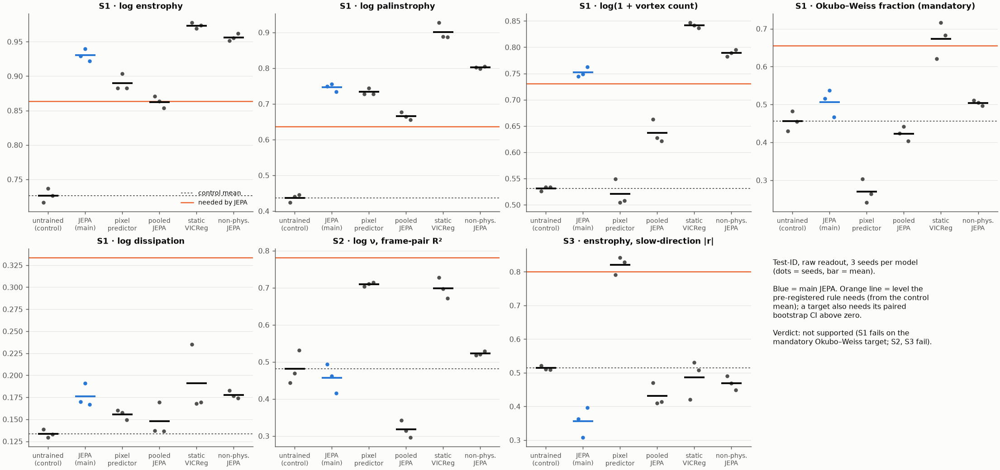

# geometric-scout: final report

2026-10-15. Pre-registered study (`PREREGISTRATION.md`, committed before any training). Test sets
evaluated once (`results/final/`, commit `e8d619e`). Every run is in `results/LOG.md`.

**Question.** Does a JEPA trained only to predict 2D Navier–Stokes flow organize its latent space
around fluid quantities measurably better than an untrained network of the same architecture?

## Bottom line

- **Verdict: not supported.** The JEPA fails all three pre-registered criteria on test-ID:
  - S1: 3 of 5 targets count, but the mandatory Okubo–Weiss target does not.
  - S2: no gain in decoding ν.
  - S3: enstrophy is *less* visible in its slow directions than in the untrained control's.
- **This is not a near miss.** S1 fails under every version of the rule (§1.2). The one version
  where it would pass also passes models that never saw real physics.
- **The controls explain the JEPA's gains.**
  - A JEPA trained on fake linear dynamics is significantly *better* than the real JEPA on
    enstrophy, palinstrophy and vortex count.
  - A static VICReg model that never sees time beats the JEPA on all four structure targets.
  - Whatever the JEPA learned over random init is generic self-supervised feature quality, not
    fluid dynamics.
- **One positive, unexpected result:** the pixel predictor (decodes future frames) meets the S3
  rule. One of its unsupervised slow directions tracks initial enstrophy, |r| 0.82 vs 0.51 for
  the control. It is the only model whose latent geometry picks out a conserved quantity.
- **Recommendation:** close the confirmatory study as "not supported". If you want to continue,
  start with one cheap exploratory check (probing the spatial maps, §8, decision 3a). It addresses
  the main measurement threat and decides whether anything else is worth running.

## 1. Verdict against the pre-registered criteria

All numbers: test-ID, raw pooled latent, mean of 3 seeds. CIs are 95% paired trajectory bootstraps.

| Criterion | Rule (§1, §2) | JEPA | Control | Needed | Outcome |
|---|---|---|---|---|---|
| S1 log enstrophy | gain ≥ 0.20 or unexplained variance halved, CI > 0 | 0.930 | 0.727 | 0.864 | counts (+0.204, CI +0.18 to +0.24) |
| S1 log palinstrophy | same | 0.746 | 0.437 | 0.637 | counts (+0.310) |
| S1 log(1 + vortex count) | same | 0.752 | 0.531 | 0.731 | counts (+0.221) |
| **S1 Okubo–Weiss fraction** | same, **and must be one of the ≥ 3** | 0.507 | 0.456 | 0.656 | **does not count** (+0.051) |
| S1 log dissipation | same | 0.176 | 0.134 | 0.334 | does not count (CI spans 0) |
| **S1** | ≥ 3 count, including Okubo–Weiss | | | | **fails** |
| **S2** log ν from a frame pair | R² ≥ 0.6 and ≥ control + 0.3 | 0.457 | 0.481 | 0.781 | **fails** (no gain) |
| **S3** enstrophy, best of top-3 slow directions | \|r\| ≥ 0.8, control < 0.8, gap ≥ 0.1, CI > 0 | 0.356 | 0.514 | 0.800 | **fails** (JEPA below control) |

Energy cannot pass S3, because the control already exceeds 0.8 (|r| 0.948); the JEPA reaches
0.794.

### 1.1 Shift-tolerance attribution (§2.6)

In the shift-averaged readout, the vortex-count gain no longer counts: +0.176, short of both bars.
Under the pre-registered interpretation rule, it is attributed to shift tolerance, not physical
structure. The enstrophy and palinstrophy gains survive. So the JEPA has **2** genuinely
attributable S1 gains, not 3.

### 1.2 How robust is the verdict to the S1 rule?

| S1 version | JEPA targets counted | S1 | Would also pass |
|---|---|---|---|
| Brief, literal (time-only partialling, +0.20 margin only) | 1/5 (palinstrophy) | fails | none |
| Pre-registered (§2.1 + §2.1a), raw readout | 3/5, Okubo–Weiss not among them | **fails** | static VICReg (4/5 incl. OW) |
| Pre-registered, shift-averaged readout | 2/5 | fails | none |
| §2.1 without the mandatory-OW clause | 3/5 | would hold → "partially supported" | non-physical JEPA (3/5), static VICReg (4/5) |

The mandatory-OW clause was adopted before training (§2.1), so that a dissipation or amplitude gain
could not pass for learned geometry. It is the clause that decides S1 here. Dropping it would not
rescue the hypothesis: the same rule then passes models trained on no dynamics or wrong dynamics.

## 2. What the controls show (the main finding)

Paired differences, JEPA minus control model, test-ID, raw readout, 95% CI. Negative means the
control is better.

| Quantity | JEPA − non-physical JEPA | JEPA − static VICReg | JEPA − pooled JEPA |
|---|---|---|---|
| log enstrophy | −0.026 [−0.034, −0.020] | −0.043 [−0.056, −0.034] | +0.068 [+0.056, +0.082] |
| log palinstrophy | −0.055 [−0.075, −0.038] | −0.154 [−0.192, −0.124] | +0.081 [+0.062, +0.104] |
| log(1 + vortex count) | −0.037 [−0.052, −0.023] | −0.090 [−0.113, −0.068] | +0.115 [+0.092, +0.141] |
| Okubo–Weiss fraction | +0.003 [−0.042, +0.051] | −0.166 [−0.233, −0.109] | +0.084 [+0.042, +0.135] |
| log dissipation | −0.002 [−0.031, +0.029] | −0.015 [−0.072, +0.047] | +0.028 [−0.006, +0.061] |
| log ν pair R² (no CI) | −0.066 | −0.242 | +0.139 |
| S3 enstrophy \|r\| | −0.114 [−0.21, +0.06] | −0.131 [−0.22, −0.02] | −0.076 [−0.11, +0.09] |

- **Non-physical JEPA** (§4.5):
  - Setup: same objective and budget, trained on linear per-mode dynamics that conserve nothing.
  - Result: it reads every S1 target at least as well as the real JEPA, significantly better on
    three of them, and also does better on ν.
  - Meaning: predicting the real dynamics adds nothing measurable over predicting arbitrary
    smooth dynamics.
- **Static VICReg** (§4.4):
  - Setup: no time at all, only invariance to random shifts and square symmetries.
  - Result: the strongest model on every S1 target, and second only to the pixel model on ν. It
    is the only model that meets S1, 4 of 5 including Okubo–Weiss, which rates "partially
    supported" against the control.
  - Meaning: the useful ingredient appears to be the symmetry-invariance objective (or its
    augmentations), not prediction.
- **Pooled-JEPA ablation** (§4.3): predicting the pooled vector instead of the spatial map is
  worse everywhere. The pre-registered choice of spatial prediction (§2.4) was the better JEPA;
  it just isn't better than the controls.

## 3. JEPA vs pixel predictor (pre-registered comparison, no pass/fail)

| Quantity | JEPA | Pixel | JEPA − pixel [CI] |
|---|---|---|---|
| log enstrophy | 0.930 | 0.890 | +0.041 [+0.024, +0.057] |
| log palinstrophy | 0.746 | 0.733 | +0.013 [−0.037, +0.052] |
| log(1 + vortex count) | 0.752 | 0.521 | +0.231 [+0.179, +0.284] |
| Okubo–Weiss fraction | 0.507 | 0.270 | +0.237 [+0.160, +0.315] |
| log ν pair R² | 0.457 | 0.710 | −0.253 |
| S3 enstrophy \|r\| | 0.356 | 0.821 | −0.465 [−0.55, −0.32] |

- **They keep different information.**
  - The JEPA keeps local structure: vortex count and the Okubo–Weiss fraction.
  - The pixel model loses it: vortex count 0.52 vs the control's 0.53 (not significant), and
    Okubo–Weiss 0.27 vs 0.46, significantly below the control.
  - The pixel model instead keeps amplitude-like quantities: ν, and the enstrophy direction.
- **The pixel model meets S3**, with gap CI +0.15 to +0.50, under both readouts.
  - Its traversal along slow direction 2 (`results/phase4_traversals_pixel.png`) is enstrophy
    made visible: the spectrum fills in at high k, the vorticity PDF widens, and the fields go
    from smooth blobs to fine-scale turbulence.
  - A plausible reason: to decode the next frame, it must carry the field's overall amplitude
    and spectral slope.
  - This is reported, unscored, and was not predicted. Treat it as a lead, not a finding.
- **Training quality doesn't explain the difference.**
  - The pixel model converged: val loss is 0.035× the copy baseline, flat at the end.
  - The JEPA reached 0.60× its copy baseline and was still improving by about 2% per 4 epochs
    at epoch 40.

## 4. Out-of-distribution test (§5.5, no pass/fail)

Test-OOD is an interior Reynolds band (Re 286–389, 150 trajectories, never seen in training or
selection). Probes are fitted on train. Each model's OOD error is compared with its error on the
41 test-ID trajectories in the neighbouring log-Re bands. Full table: appendix A3.

- **No model breaks down.** OOD/neighbour MSE ratios are 0.71–1.46 across all models and targets.
  For the JEPA they are 0.98 (enstrophy), 1.17 (palinstrophy), 1.10 (vortex count),
  0.76 (Okubo–Weiss) and 1.31 (ν).
- **Dissipation and ν are about 1.3× worse OOD for every model**, the control included. That is
  a property of the band, not of training.
- **ν from a single frame is weak everywhere.** For the JEPA, the control, the pooled JEPA and the
  non-physical JEPA, the OOD ν probe is no better than predicting the train mean (MSE 0.85–0.87
  vs 0.81). Only the pixel model and static VICReg beat it (0.70, 0.71).

## 5. Phase 4 views (unscored)

- PCA and t-SNE of val latents for all six models, coloured by enstrophy, vortex count and ν:
  `results/phase4_pca.png`, `results/phase4_tsne.png`.
  - The untrained latent is dominated by one amplitude-like direction (86% of PCA variance).
  - Trained latents spread variance over many directions.
- Traversals along the top-3 slow directions for the untrained, JEPA and pixel models:
  `results/phase4_traversals_*.png`.
  - In the JEPA, no direction tracks enstrophy cleanly. Its direction 2 tracks energy instead
    (trajectory |r| 0.78).

## 6. Threats to validity

1. **Pooled readout.**
   - Every probe reads the 128-d spatial mean of the encoder's 8×8×128 map, as pre-registered,
     identically for all models.
   - The JEPA is trained to predict the *map*, so structure it learned may sit in spatial
     patterns that pooling discards.
   - This is the largest measurement threat, and the cheapest to test (decision 3a).
2. **Narrow tuning, possibly under-trained JEPA.**
   - The lr grid had two points, and all five models chose the upper one (1e-3), so the optimum
     may lie above the grid.
   - Training was a fixed 40 epochs, and the JEPA's val loss was still falling.
   - Counterpoint: the non-physical JEPA and static VICReg had the same budget and grid, and
     still beat it.
3. **Short prediction horizons.**
   - k ∈ {1, 4} frames is 0.04–0.16 time units ahead, so copying the current frame is already
     a strong prediction.
   - The task may not require knowing ν or the invariants, which could explain S2.
4. **S3 is unstable.**
   - The control's enstrophy |r| was 0.23 on val (directions fitted on train) and 0.51 on test
     (fitted on train+val, as pre-registered).
   - It rests on 74 inviscid test trajectories and a max over 3 directions.
   - The seeds agree closely (± 0.01), so the swing comes from the fitting and evaluation sets.
     Read S3 values as roughly ± 0.2.
5. **The CIs ignore seed variance.**
   - The bootstrap resamples trajectories, not seeds. With 3 seeds, seed spread is shown
     separately (± std in the appendix).
   - Where seed std is comparable to a gap (e.g. Okubo–Weiss ± 0.04), the CI overstates
     certainty.
6. **Strong untrained baseline.**
   - Kaiming-initialized conv features with z-scored ridge probes already read most quantities
     well (enstrophy R² 0.73).
   - That is the correct control, but it sets a high bar any trained model has to clear.
7. **Rule design.** The verdict hinges on the mandatory Okubo–Weiss clause (§1.2). It was set
   before training and for a stated reason. Dropping it changes the label but not the conclusion.
8. **Control differences.**
   - The non-physical data change more slowly per frame (median 0.027 vs 0.038), so its
     prediction task is easier. That cuts against the JEPA anyway.
   - Static VICReg sees augmentations the JEPA never sees. That is an explanation to test, not a
     flaw.
9. **Process.**
   - Val results were seen before test. After that, the only changes were an output-encoding fix
     and the Phase 4 traversal readout, which is unscored.
   - The final config was committed before the test run.
   - Its code path was dry-run on train/val with no test rows read.
   - The test run was executed once.
10. **Scope.**
    - One architecture: a small CNN with no normalization.
    - 64² resolution, decaying unforced flow, short inviscid windows (24 frames).

## 7. The 2D limitation

- 2D Navier–Stokes has no vortex stretching, and enstrophy is an inviscid invariant only in 2D.
- The energy cascade is inverse, and the dynamics are far more constrained than in 3D.
- Even a positive S3 here would not have shown that such models find invariants of 3D flow.
- The negative result doesn't transfer either. It says nothing about larger models, other
  readouts, or 3D.

## 8. Decisions for you

**Decision 1: accept the verdict and close the confirmatory study?** Recommended: **yes.**
- S1 fails under every version of the rule, and S2 and S3 fail outright.
- The controls account for the gains that do exist. There is no near miss to rescue.
- The test set is now spent. Any new confirmatory claim needs a new pre-registration and freshly
  generated test data (about 5 min to generate).

**Decision 2: write it up?** Recommended: **yes, if you want something shareable.**
- The design is the contribution: pre-registration, physics-free and time-free controls, a
  shift-averaged readout, and a single test touch.
- "A JEPA trained on fake dynamics, or a static invariance model, matches or beats a JEPA trained
  on real Navier–Stokes" is a useful negative result.
- Cost: writing only, no compute.

**Decision 3: explore further?** All of this would be exploratory and labelled so.

| Option | Question it answers | Compute (RTX 3060) | My take |
|---|---|---|---|
| **3a. Probe the 8×8 spatial maps** instead of pooled latents | Did pooling hide the JEPA's physics? (threat 1) | ~1–2 h, existing checkpoints | **Do first.** Cheapest, and it decides whether anything else is worth running |
| 3b. JEPA with static VICReg's augmentations; VICReg without them | Is the static model's edge the augmentations or the objective? | ~3 h (2 models × 3 seeds) + probes | Worth it if 3a still shows the controls ahead |
| 3c. Pixel model's enstrophy direction | Why does decoding frames keep an invariant direction? | < 1 h, existing latents | Cheap lead. The only "physics-like" positive |
| 3d. Longer horizons (k up to 16–32), 80 epochs, lr grid to 3e-3 | Was the task too easy, or the JEPA under-trained? (threats 2, 3) | ~6–8 h | Only if 3a shows the JEPA's maps carry physics the pooled latent lacks |

**Suggested order:** 3a, then decide between 3b and 3d based on its result, with 3c on the side.
If 3a shows the JEPA's maps are no better than the controls' maps, I'd stop. The conclusion would
then be robust to the main threat.

## 9. Compute used

All runs on one machine: NVIDIA RTX 3060 (12 GB), Python 3.13, torch 2.11 + CUDA 12.8. Wall-clock
from `results/LOG.md`:

| Phase | What | Wall-clock |
|---|---|---|
| 0 | Solver validation, benchmark, data-design pilot | 0.17 h |
| 1 | Data generation (2,000 trajectories), untrained baselines | 0.14 h |
| 2 | 22 training runs (2 smoke, 8 for 2a, 12 for 2b); about 25 min each, peak GPU memory 4.5 GB | 8.17 h |
| 2b | Non-physical dataset | 0.08 h |
| 3 | Val preview (probes; shift-averaged latents dominate) | 2.16 h |
| 4 | Views | 0.04 h |
| Final | Single test evaluation | 0.71 h |
| **Total logged** | | **11.5 h** |

Not included: about 70 throwaway CPU planning pilots before the project (summarized at the top of
the log), the final-evaluation dry run (a few minutes), and the crashed Phase 3 raw-only run
(~8 min).

## 10. Deviations and incidents (all logged)

- **Before training:** the §2 clarifications, including time × family partialling (§2.1a), and
  amendment A1 (the no-collapse rule applies only to collapse-prone objectives).
- **Phase 3 raw-only run crashed** at its final console print (Windows cp1252 encoding).
  - Its outputs were complete.
  - The fix only reconfigures stdout, in the Phase 3 and final scripts.
- **Phase 4 traversal readout changed** after its first run (unscored figure).
  - Nearest neighbours in the full 32-dim space returned the same trajectory for several steps.
  - Changed to frames nearest each step along the slow coordinate, and extended to the top-3
    directions.
- **Phase 4 views were only loosely specified** in the pre-registration. They were implemented as
  described in §5 (seed 0, fitted on train, shown on val).
- **The final evaluation ran once, with no rerun.** Its log line shows "+dirty" only because the
  run's own output files existed when it logged; the tree was clean at `c2c3a79` when it started.

## Appendix: full tables

Generated from `results/final/final_evaluation.json`. Columns are the six models; each cell is mean
± std over 3 seeds. Abbreviations: `jepa_spatial` = main JEPA; `untrained` = the control; `pixel` =
pixel predictor; `jepa_pooled` = pooled-JEPA ablation; `static_vicreg` = static control;
`nonphys_jepa_spatial` = non-physical-dynamics control. The compact rule outputs are also in
`results/final/final_evaluation.md`.

### A1. Test-ID, raw pooled latent (primary readout)

| quantity | untrained | jepa_spatial | pixel | jepa_pooled | static_vicreg | nonphys_jepa_spatial |
|---|---|---|---|---|---|---|
| log enstrophy Z (R², time × family partialled) | 0.727 ± 0.010 | 0.930 ± 0.009 | 0.890 ± 0.012 | 0.862 ± 0.009 | 0.973 ± 0.004 | 0.956 ± 0.005 |
| log palinstrophy P (R², time × family partialled) | 0.437 ± 0.012 | 0.746 ± 0.011 | 0.733 ± 0.010 | 0.665 ± 0.011 | 0.900 ± 0.023 | 0.802 ± 0.003 |
| log(1 + vortex count) (R², time × family partialled) | 0.531 ± 0.004 | 0.752 ± 0.009 | 0.521 ± 0.025 | 0.637 ± 0.022 | 0.842 ± 0.005 | 0.789 ± 0.006 |
| Okubo–Weiss vorticity fraction (R², time × family partialled) | 0.456 ± 0.026 | 0.507 ± 0.036 | 0.270 ± 0.032 | 0.423 ± 0.020 | 0.673 ± 0.049 | 0.504 ± 0.007 |
| log dissipation ε (viscous) (R², time × family partialled) | 0.134 ± 0.005 | 0.176 ± 0.013 | 0.156 ± 0.005 | 0.148 ± 0.019 | 0.191 ± 0.038 | 0.178 ± 0.005 |
| log energy E (R², time × family partialled) | 0.924 ± 0.006 | 0.976 ± 0.001 | 0.956 ± 0.007 | 0.910 ± 0.017 | 0.973 ± 0.006 | 0.985 ± 0.002 |
| log max\|ω\| (R², time × family partialled) | 0.575 ± 0.032 | 0.772 ± 0.024 | 0.708 ± 0.011 | 0.702 ± 0.022 | 0.895 ± 0.008 | 0.783 ± 0.003 |
| log vorticity kurtosis (R², time × family partialled) | 0.565 ± 0.033 | 0.588 ± 0.045 | 0.329 ± 0.029 | 0.500 ± 0.020 | 0.812 ± 0.049 | 0.577 ± 0.016 |
| Okubo–Weiss strain fraction (R², time × family partialled) | 0.381 ± 0.013 | 0.342 ± 0.017 | 0.277 ± 0.027 | 0.284 ± 0.022 | 0.560 ± 0.042 | 0.386 ± 0.033 |
| log enstrophy Z (R², time-only partialled) | 0.779 ± 0.005 | 0.947 ± 0.007 | 0.916 ± 0.010 | 0.897 ± 0.006 | 0.980 ± 0.003 | 0.966 ± 0.005 |
| log palinstrophy P (R², time-only partialled) | 0.471 ± 0.011 | 0.767 ± 0.009 | 0.760 ± 0.010 | 0.693 ± 0.010 | 0.911 ± 0.021 | 0.816 ± 0.002 |
| log(1 + vortex count) (R², time-only partialled) | 0.901 ± 0.003 | 0.949 ± 0.002 | 0.888 ± 0.003 | 0.917 ± 0.008 | 0.967 ± 0.001 | 0.958 ± 0.001 |
| Okubo–Weiss vorticity fraction (R², time-only partialled) | 0.824 ± 0.013 | 0.859 ± 0.002 | 0.710 ± 0.004 | 0.819 ± 0.009 | 0.912 ± 0.015 | 0.856 ± 0.007 |
| log dissipation ε (viscous) (R², time-only partialled) | 0.222 ± 0.013 | 0.246 ± 0.009 | 0.243 ± 0.011 | 0.222 ± 0.017 | 0.287 ± 0.039 | 0.253 ± 0.005 |
| log ν, frame pair R² (S2) | 0.481 ± 0.045 | 0.457 ± 0.039 | 0.710 ± 0.005 | 0.317 ± 0.024 | 0.699 ± 0.028 | 0.522 ± 0.006 |
| log ν, single frame R² | 0.105 ± 0.007 | 0.174 ± 0.008 | 0.222 ± 0.015 | 0.159 ± 0.006 | 0.311 ± 0.036 | 0.193 ± 0.016 |
| time, plain R² | 0.232 ± 0.003 | 0.310 ± 0.005 | 0.324 ± 0.009 | 0.276 ± 0.010 | 0.360 ± 0.034 | 0.320 ± 0.005 |
| slow-direction max \|r\|: log_E | 0.948 ± 0.005 | 0.794 ± 0.042 | 0.916 ± 0.010 | 0.702 ± 0.085 | 0.667 ± 0.146 | 0.734 ± 0.040 |
| slow-direction max \|r\|: log_Z | 0.514 ± 0.006 | 0.356 ± 0.045 | 0.821 ± 0.026 | 0.431 ± 0.033 | 0.486 ± 0.059 | 0.470 ± 0.021 |
| slow-direction max \|r\|: log_C4 | 0.732 ± 0.004 | 0.462 ± 0.077 | 0.722 ± 0.004 | 0.416 ± 0.091 | 0.545 ± 0.107 | 0.576 ± 0.041 |
| slow-direction max \|r\|: kurtosis (traj mean) | 0.381 ± 0.005 | 0.467 ± 0.046 | 0.343 ± 0.010 | 0.496 ± 0.031 | 0.450 ± 0.018 | 0.354 ± 0.075 |
| slow-direction max \|r\|: log max\|w\| (traj mean) | 0.625 ± 0.003 | 0.400 ± 0.054 | 0.613 ± 0.003 | 0.379 ± 0.078 | 0.514 ± 0.147 | 0.500 ± 0.045 |
| slow-direction max \|r\|: OW fraction (traj mean) | 0.630 ± 0.002 | 0.642 ± 0.090 | 0.576 ± 0.007 | 0.641 ± 0.022 | 0.554 ± 0.005 | 0.497 ± 0.109 |
| slow-direction held-out λ, direction 1 | 0.000 ± 0.000 | 0.005 ± 0.001 | 0.000 ± 0.000 | 0.021 ± 0.005 | 0.002 ± 0.000 | 0.008 ± 0.002 |
| slow-direction held-out λ, direction 2 | 0.029 ± 0.009 | 0.008 ± 0.000 | 0.007 ± 0.001 | 0.028 ± 0.004 | 0.003 ± 0.001 | 0.012 ± 0.002 |
| slow-direction held-out λ, direction 3 | 0.043 ± 0.012 | 0.019 ± 0.004 | 0.010 ± 0.002 | 0.051 ± 0.014 | 0.004 ± 0.001 | 0.021 ± 0.004 |
| MLP probe: log enstrophy Z | 0.835 ± 0.009 | 0.950 ± 0.010 | 0.964 ± 0.004 | 0.903 ± 0.007 | 0.992 ± 0.001 | 0.970 ± 0.006 |
| MLP probe: log palinstrophy P | 0.524 ± 0.023 | 0.754 ± 0.021 | 0.905 ± 0.008 | 0.688 ± 0.010 | 0.916 ± 0.019 | 0.800 ± 0.012 |
| MLP probe: log(1 + vortex count) | 0.583 ± 0.036 | 0.759 ± 0.015 | 0.729 ± 0.005 | 0.666 ± 0.005 | 0.860 ± 0.003 | 0.784 ± 0.017 |
| MLP probe: Okubo–Weiss vorticity fraction | 0.521 ± 0.005 | 0.530 ± 0.034 | 0.386 ± 0.028 | 0.488 ± 0.009 | 0.688 ± 0.053 | 0.531 ± 0.028 |
| MLP probe: log dissipation ε (viscous) | 0.117 ± 0.027 | 0.161 ± 0.017 | 0.194 ± 0.006 | 0.113 ± 0.020 | 0.190 ± 0.031 | 0.176 ± 0.009 |

### A2. Test-ID, latent averaged over the 64 sub-stride shifts (secondary readout, §2.6)

| quantity | untrained | jepa_spatial | pixel | jepa_pooled | static_vicreg | nonphys_jepa_spatial |
|---|---|---|---|---|---|---|
| log enstrophy Z (R², time × family partialled) | 0.763 ± 0.016 | 0.931 ± 0.009 | 0.918 ± 0.014 | 0.865 ± 0.009 | 0.974 ± 0.004 | 0.957 ± 0.006 |
| log palinstrophy P (R², time × family partialled) | 0.491 ± 0.013 | 0.747 ± 0.011 | 0.772 ± 0.015 | 0.668 ± 0.011 | 0.901 ± 0.023 | 0.802 ± 0.005 |
| log(1 + vortex count) (R², time × family partialled) | 0.575 ± 0.004 | 0.751 ± 0.009 | 0.608 ± 0.048 | 0.639 ± 0.021 | 0.842 ± 0.005 | 0.792 ± 0.009 |
| Okubo–Weiss vorticity fraction (R², time × family partialled) | 0.502 ± 0.010 | 0.509 ± 0.032 | 0.399 ± 0.040 | 0.425 ± 0.021 | 0.674 ± 0.049 | 0.508 ± 0.001 |
| log dissipation ε (viscous) (R², time × family partialled) | 0.133 ± 0.002 | 0.177 ± 0.014 | 0.174 ± 0.006 | 0.151 ± 0.024 | 0.190 ± 0.037 | 0.179 ± 0.004 |
| log energy E (R², time × family partialled) | 0.936 ± 0.007 | 0.977 ± 0.001 | 0.969 ± 0.008 | 0.913 ± 0.017 | 0.973 ± 0.006 | 0.986 ± 0.002 |
| log max\|ω\| (R², time × family partialled) | 0.609 ± 0.036 | 0.773 ± 0.024 | 0.761 ± 0.023 | 0.704 ± 0.022 | 0.896 ± 0.009 | 0.783 ± 0.001 |
| log vorticity kurtosis (R², time × family partialled) | 0.618 ± 0.032 | 0.588 ± 0.042 | 0.489 ± 0.056 | 0.502 ± 0.020 | 0.811 ± 0.050 | 0.581 ± 0.017 |
| Okubo–Weiss strain fraction (R², time × family partialled) | 0.408 ± 0.017 | 0.345 ± 0.015 | 0.344 ± 0.011 | 0.285 ± 0.028 | 0.561 ± 0.041 | 0.387 ± 0.029 |
| log enstrophy Z (R², time-only partialled) | 0.810 ± 0.011 | 0.948 ± 0.007 | 0.937 ± 0.010 | 0.899 ± 0.006 | 0.980 ± 0.003 | 0.966 ± 0.005 |
| log palinstrophy P (R², time-only partialled) | 0.527 ± 0.012 | 0.767 ± 0.010 | 0.796 ± 0.014 | 0.696 ± 0.010 | 0.912 ± 0.020 | 0.816 ± 0.003 |
| log(1 + vortex count) (R², time-only partialled) | 0.914 ± 0.001 | 0.949 ± 0.002 | 0.918 ± 0.013 | 0.918 ± 0.008 | 0.967 ± 0.001 | 0.959 ± 0.001 |
| Okubo–Weiss vorticity fraction (R², time-only partialled) | 0.844 ± 0.012 | 0.859 ± 0.002 | 0.794 ± 0.025 | 0.820 ± 0.011 | 0.912 ± 0.015 | 0.857 ± 0.007 |
| log dissipation ε (viscous) (R², time-only partialled) | 0.225 ± 0.006 | 0.248 ± 0.012 | 0.265 ± 0.002 | 0.224 ± 0.021 | 0.287 ± 0.039 | 0.253 ± 0.006 |
| log ν, frame pair R² (S2) | 0.601 ± 0.029 | 0.475 ± 0.040 | 0.793 ± 0.008 | 0.331 ± 0.030 | 0.708 ± 0.027 | 0.542 ± 0.012 |
| log ν, single frame R² | 0.106 ± 0.003 | 0.174 ± 0.008 | 0.264 ± 0.006 | 0.160 ± 0.008 | 0.312 ± 0.036 | 0.191 ± 0.016 |
| time, plain R² | 0.260 ± 0.006 | 0.311 ± 0.006 | 0.383 ± 0.021 | 0.279 ± 0.010 | 0.361 ± 0.034 | 0.323 ± 0.003 |
| slow-direction max \|r\|: log_E | 0.952 ± 0.006 | 0.792 ± 0.065 | 0.915 ± 0.005 | 0.673 ± 0.137 | 0.660 ± 0.157 | 0.748 ± 0.067 |
| slow-direction max \|r\|: log_Z | 0.514 ± 0.006 | 0.350 ± 0.006 | 0.855 ± 0.012 | 0.382 ± 0.060 | 0.484 ± 0.064 | 0.454 ± 0.027 |
| slow-direction max \|r\|: log_C4 | 0.736 ± 0.004 | 0.487 ± 0.075 | 0.717 ± 0.008 | 0.463 ± 0.074 | 0.559 ± 0.101 | 0.570 ± 0.037 |
| slow-direction max \|r\|: kurtosis (traj mean) | 0.389 ± 0.003 | 0.474 ± 0.039 | 0.346 ± 0.008 | 0.472 ± 0.060 | 0.467 ± 0.024 | 0.379 ± 0.078 |
| slow-direction max \|r\|: log max\|w\| (traj mean) | 0.629 ± 0.003 | 0.413 ± 0.067 | 0.609 ± 0.007 | 0.419 ± 0.061 | 0.526 ± 0.141 | 0.494 ± 0.044 |
| slow-direction max \|r\|: OW fraction (traj mean) | 0.637 ± 0.004 | 0.648 ± 0.067 | 0.579 ± 0.000 | 0.600 ± 0.032 | 0.557 ± 0.026 | 0.516 ± 0.086 |
| slow-direction held-out λ, direction 1 | 0.000 ± 0.000 | 0.005 ± 0.000 | 0.000 ± 0.000 | 0.020 ± 0.005 | 0.002 ± 0.000 | 0.008 ± 0.002 |
| slow-direction held-out λ, direction 2 | 0.013 ± 0.002 | 0.008 ± 0.000 | 0.003 ± 0.001 | 0.026 ± 0.005 | 0.003 ± 0.001 | 0.011 ± 0.002 |
| slow-direction held-out λ, direction 3 | 0.032 ± 0.014 | 0.018 ± 0.003 | 0.006 ± 0.001 | 0.050 ± 0.012 | 0.004 ± 0.001 | 0.021 ± 0.004 |

### A3. Test-OOD (interior Re band 286–389, 150 trajectories): probe MSE, mean ± std over seeds

Probes fitted on train (plain ridge, single frame). Each cell: MSE on test-OOD; below it, in the second table, MSE on the 41 test-ID viscous trajectories in the neighbouring log-Re bands [0.35, 0.45) ∪ (0.55, 0.65]. Last column: a constant predictor at the train mean.

**MSE on test-OOD**

| target | untrained | jepa_spatial | pixel | jepa_pooled | static_vicreg | nonphys_jepa_spatial | constant |
|---|---|---|---|---|---|---|---|
| log enstrophy Z | 0.0555 ± 0.0038 | 0.0317 ± 0.0064 | 0.0152 ± 0.0015 | 0.0493 ± 0.0042 | 0.0065 ± 0.0004 | 0.0184 ± 0.0033 | 0.1729 |
| log palinstrophy P | 0.3120 ± 0.0072 | 0.3304 ± 0.0286 | 0.1647 ± 0.0103 | 0.3896 ± 0.0217 | 0.0966 ± 0.0275 | 0.2456 ± 0.0163 | 0.9789 |
| log(1 + vortex count) | 0.0769 ± 0.0071 | 0.0520 ± 0.0015 | 0.1092 ± 0.0115 | 0.0964 ± 0.0153 | 0.0379 ± 0.0064 | 0.0451 ± 0.0047 | 0.9839 |
| Okubo–Weiss vorticity fraction | 0.0013 ± 0.0001 | 0.0010 ± 0.0000 | 0.0022 ± 0.0002 | 0.0014 ± 0.0001 | 0.0007 ± 0.0001 | 0.0011 ± 0.0001 | 0.0067 |
| log dissipation ε (viscous) | 0.7435 ± 0.0253 | 0.7685 ± 0.0104 | 0.7009 ± 0.0140 | 0.7588 ± 0.0152 | 0.7103 ± 0.0296 | 0.7794 ± 0.0168 | 1.0636 |
| log energy E | 0.0192 ± 0.0011 | 0.0100 ± 0.0026 | 0.0219 ± 0.0029 | 0.0354 ± 0.0086 | 0.0101 ± 0.0014 | 0.0062 ± 0.0007 | 0.9021 |
| log max\|ω\| | 0.0378 ± 0.0027 | 0.0347 ± 0.0043 | 0.0321 ± 0.0021 | 0.0399 ± 0.0028 | 0.0110 ± 0.0023 | 0.0332 ± 0.0028 | 0.0736 |
| log vorticity kurtosis | 0.0585 ± 0.0060 | 0.0492 ± 0.0033 | 0.0960 ± 0.0070 | 0.0612 ± 0.0044 | 0.0218 ± 0.0070 | 0.0552 ± 0.0042 | 0.2531 |
| Okubo–Weiss strain fraction | 0.0019 ± 0.0001 | 0.0022 ± 0.0002 | 0.0023 ± 0.0001 | 0.0023 ± 0.0002 | 0.0013 ± 0.0001 | 0.0022 ± 0.0001 | 0.0034 |
| log ν (viscous) | 0.8554 ± 0.0349 | 0.8716 ± 0.0390 | 0.7018 ± 0.0085 | 0.8564 ± 0.0103 | 0.7076 ± 0.0482 | 0.8529 ± 0.0065 | 0.8100 |

**MSE on neighbouring test-ID bands**

| target | untrained | jepa_spatial | pixel | jepa_pooled | static_vicreg | nonphys_jepa_spatial | constant |
|---|---|---|---|---|---|---|---|
| log enstrophy Z | 0.0642 ± 0.0081 | 0.0324 ± 0.0075 | 0.0191 ± 0.0019 | 0.0429 ± 0.0057 | 0.0065 ± 0.0009 | 0.0163 ± 0.0032 | 0.1842 |
| log palinstrophy P | 0.3201 ± 0.0192 | 0.2827 ± 0.0180 | 0.1518 ± 0.0093 | 0.3159 ± 0.0183 | 0.0782 ± 0.0209 | 0.1966 ± 0.0050 | 0.9972 |
| log(1 + vortex count) | 0.0812 ± 0.0122 | 0.0472 ± 0.0061 | 0.1017 ± 0.0110 | 0.0745 ± 0.0131 | 0.0304 ± 0.0046 | 0.0337 ± 0.0033 | 0.9975 |
| Okubo–Weiss vorticity fraction | 0.0016 ± 0.0004 | 0.0013 ± 0.0000 | 0.0027 ± 0.0000 | 0.0015 ± 0.0001 | 0.0009 ± 0.0003 | 0.0012 ± 0.0001 | 0.0082 |
| log dissipation ε (viscous) | 0.5855 ± 0.0294 | 0.5893 ± 0.0105 | 0.5592 ± 0.0183 | 0.5901 ± 0.0316 | 0.5537 ± 0.0447 | 0.5734 ± 0.0270 | 0.7754 |
| log energy E | 0.0206 ± 0.0029 | 0.0107 ± 0.0021 | 0.0299 ± 0.0059 | 0.0313 ± 0.0057 | 0.0089 ± 0.0003 | 0.0065 ± 0.0005 | 0.7512 |
| log max\|ω\| | 0.0386 ± 0.0049 | 0.0309 ± 0.0037 | 0.0363 ± 0.0042 | 0.0337 ± 0.0031 | 0.0103 ± 0.0013 | 0.0228 ± 0.0010 | 0.0976 |
| log vorticity kurtosis | 0.0640 ± 0.0190 | 0.0474 ± 0.0015 | 0.1140 ± 0.0090 | 0.0522 ± 0.0039 | 0.0214 ± 0.0102 | 0.0394 ± 0.0043 | 0.3215 |
| Okubo–Weiss strain fraction | 0.0018 ± 0.0001 | 0.0019 ± 0.0001 | 0.0022 ± 0.0002 | 0.0019 ± 0.0002 | 0.0012 ± 0.0002 | 0.0016 ± 0.0001 | 0.0035 |
| log ν (viscous) | 0.6902 ± 0.0123 | 0.6663 ± 0.0316 | 0.5566 ± 0.0100 | 0.6508 ± 0.0057 | 0.5668 ± 0.0581 | 0.6239 ± 0.0254 | 0.6359 |

### A4. Pre-registered rules applied to every model vs the untrained control (only the JEPA row is the verdict)

| model | readout | S1 targets counted | OW counts | S1 | S2 (pair R², model vs control) | S3 (enstrophy \|r\|, model vs control; CI of gap) | rule outcome |
|---|---|---|---|---|---|---|---|
| jepa_spatial | raw | 3/5 (log_Z, log_P, log1p_vortex_count) | no | fails | 0.457 vs 0.481 → fails | 0.356 vs 0.514 [-0.31, +0.13] → fails | not supported |
| pixel | raw | 2/5 (log_Z, log_P) | no | fails | 0.710 vs 0.481 → fails | 0.821 vs 0.514 [+0.15, +0.50] → holds | not supported |
| jepa_pooled | raw | 1/5 (log_P) | no | fails | 0.317 vs 0.481 → fails | 0.431 vs 0.514 [-0.35, +0.18] → fails | not supported |
| static_vicreg | raw | 4/5 (log_Z, log_P, log1p_vortex_count, ow_vort_frac) | yes | holds | 0.699 vs 0.481 → fails | 0.486 vs 0.514 [-0.19, +0.21] → fails | partially supported |
| nonphys_jepa_spatial | raw | 3/5 (log_Z, log_P, log1p_vortex_count) | no | fails | 0.522 vs 0.481 → fails | 0.470 vs 0.514 [-0.19, +0.13] → fails | not supported |
| jepa_spatial | shift_avg | 2/5 (log_Z, log_P) | no | fails | 0.475 vs 0.601 → fails | 0.350 vs 0.514 [-0.30, +0.11] → fails | not supported |
| pixel | shift_avg | 2/5 (log_Z, log_P) | no | fails | 0.793 vs 0.601 → fails | 0.855 vs 0.514 [+0.18, +0.52] → holds | not supported |
| jepa_pooled | shift_avg | 0/5 (none) | no | fails | 0.331 vs 0.601 → fails | 0.382 vs 0.514 [-0.36, +0.14] → fails | not supported |
| static_vicreg | shift_avg | 3/5 (log_Z, log_P, log1p_vortex_count) | no | fails | 0.708 vs 0.601 → fails | 0.484 vs 0.514 [-0.19, +0.21] → fails | not supported |
| nonphys_jepa_spatial | shift_avg | 3/5 (log_Z, log_P, log1p_vortex_count) | no | fails | 0.542 vs 0.601 → fails | 0.454 vs 0.514 [-0.19, +0.11] → fails | not supported |

### A5. S1 per-target detail, JEPA vs control (raw readout, test-ID)

| target | JEPA R² | control R² | gain | 95% paired-bootstrap CI | margin (≥ 0.20) or halving | counts |
|---|---|---|---|---|---|---|
| log enstrophy Z | 0.930 | 0.727 | +0.204 | [+0.175, +0.235] | yes | **yes** |
| log palinstrophy P | 0.746 | 0.437 | +0.310 | [+0.254, +0.366] | yes | **yes** |
| log(1 + vortex count) | 0.752 | 0.531 | +0.221 | [+0.178, +0.275] | yes | **yes** |
| Okubo–Weiss vorticity fraction | 0.507 | 0.456 | +0.051 | [+0.002, +0.110] | no | no |
| log dissipation ε (viscous) | 0.176 | 0.134 | +0.042 | [-0.005, +0.085] | no | no |

Shift-averaged attribution (§2.6): log enstrophy Z: gain survives shift averaging; log palinstrophy P: gain survives shift averaging; log(1 + vortex count): gain attributed to shift-tolerance (§2.6); Okubo–Weiss vorticity fraction: no counted gain; log dissipation ε (viscous): no counted gain.
