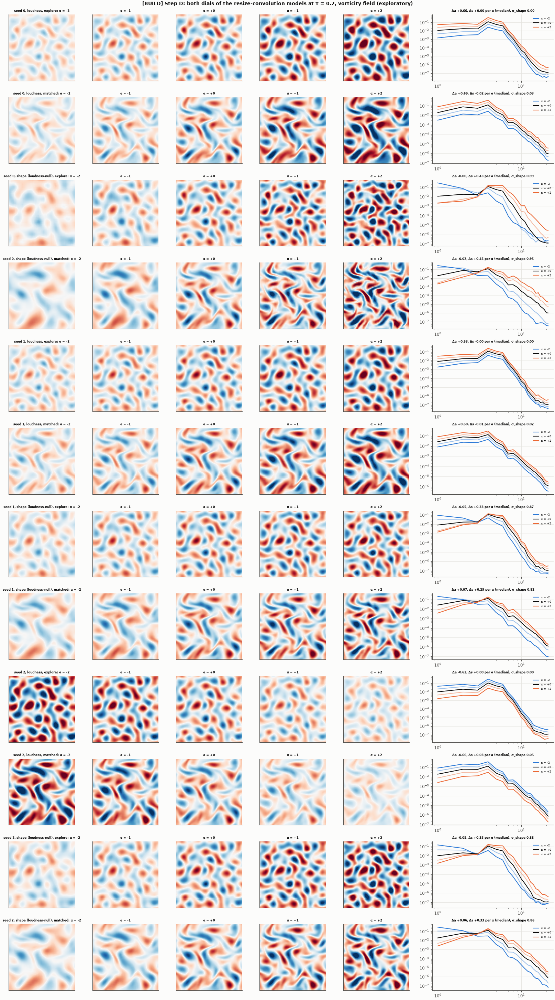
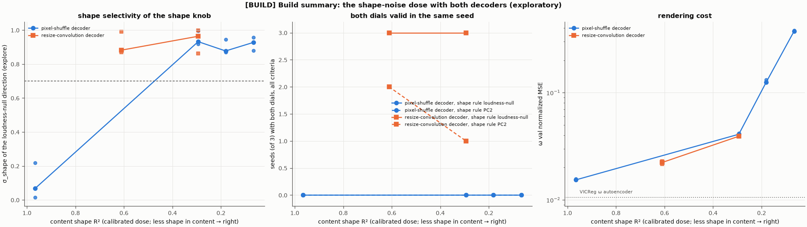

# [BUILD] Build report: a model with a loudness dial and a shape dial

**Status: exploratory.** Nothing in this report is confirmed. Every result comes from exploration data
(`explore`, `matched-energy`), and several of the rules that produced the final result were chosen
after seeing earlier results. Only a confirmation on fresh seeds and the sealed `confirm3` set, under a
pre-registration written in advance, can test it. A draft of the design choices for that confirmation
is at the end; it is not a pre-registration, and nothing in it has been decided.

Wording used throughout: a **dial** is a direction in the model's latent space whose movement produces
a measured change in the decoded field. A **loudness dial** changes a = log E (the field's energy) and
leaves s = log(Z/E) (how much of it sits at fine scales) almost unchanged. A **shape dial** changes s at
roughly fixed a: "turn enstrophy up at fixed energy". No claim is made that a model "knows" anything.

---

## 1. Bottom line

1. **Yes, both dials now exist in one model, found without labels, in every seed.** The final design
   is a two-branch autoencoder (scale-free content branch, 8-number dial branch, one decoder). Its
   content input carries random spectral-shape noise (dose τ = 0.2), and its decoder uses
   resize-convolution. In all 3 seeds:
   - a **loudness dial** (the dial direction closest to a pure rescaling of the output) moves a by
     0.50–0.69 per unit of steering at σ_shape ≤ 0.05;
   - a **shape dial** (the top data direction among dial directions that leave loudness unchanged to
     first order) moves s by 0.29–0.46 per unit at σ_shape 0.82–0.99;
   - both pass every committed criterion, on both test sets, including the realism and artefact checks.
   The pre-committed primary shape rule (PC2 of the dial vector) gives a shape dial in 2 of 3 seeds.
2. **The decisive idea was the one-route principle.** A shape dial appeared only once the content
   branch could no longer supply the field's spectral shape. While content saw the shape, the decoder
   took it from there and the dials carried only loudness, even when they held shape information.
3. **The decisive engineering fix was the decoder.** Every strong dial before Step C produced
   grid/checkerboard artefacts in a minority of frames at the ends of the steering range. They came
   from the sub-pixel-convolution (PixelShuffle) upsampling. Resize-convolution removed them
   completely (0.0% artefact frames).
4. **The cost is rendering.** The final model's vorticity error is 0.022 (normalized MSE). That's 1.5×
   the no-noise model (0.015), 2.1× the VICReg autoencoder (0.0105), and 19× the plain autoencoder
   (0.0012). The brief's rendering trigger still fires, narrowly.
5. **Compute:** about 17.8 GPU-hours of the 18.5 allowed (17.2 logged), 31 models trained.

---

## 2. How dials were judged

Each candidate direction was steered by α·σ_d for α from −2 to +2 (σ_d = the training data's spread
along that direction). It was measured on 256 `explore` frames and 256 `matched-energy` frames (all at
the same energy), and had to pass on both:

- **Size:** a and s together move by at least 0.2 log-units per unit α. Raised from 0.1 after Stage 0:
  the best existing direction reached 0.086.
- **Selectivity:** σ_shape = |Δs| / (|Δa| + |Δs|) ≤ 0.2 for loudness, ≥ 0.7 for shape.
- **Monotone:** Spearman ≥ 0.9.
- **Round trip:** re-encoding the steered field moves the latent along the same direction (correlation
  ≥ 0.9, gain 0.5–2).
- **Realism:** the steered spectra stay as close to the data's range as an ideal dial making the same
  change would (within 0.05); no frame-independent "watermark" pattern; and, from Step A on, the
  **grid-artefact criterion**. At most 1% of frames may put more than 1% of their power outside the
  solver's dealiasing band, where real fields have none.
- **Model level:** a design "produces" a dial if at least 2 of its 3 seeds have one.

All thresholds were committed before the models they judged were trained
(`PREDICTIONS.md`, entries 2 and 6). The artefact criterion's threshold and its 1% tolerance were
calibrated on one known-bad case after seeing data; this is recorded, with its sensitivity, in entry 6.

---

## 3. The path

| Step | Model | What changed | Result |
|---|---|---|---|
| 0 | Existing autoencoders and imaginer (21 models) | Measure only | 0 of 84 candidate directions are dials. The best moves the field by 0.086 per unit. The supervised s-direction predicts s almost perfectly (\|r\| 0.97–0.99) yet moves nothing: **readable, not steerable**. |
| 1 | M1-spec, M1-G (channel-split latent, two heads) | Brief's design, plus a FiLM variant | No dials. M1-G's loudness knob fails the round trip: the normalized content still carries loudness (R² 0.99), so the decoder takes it from there. |
| 2 | M2-SF (separate branches, scale-free content) | Content made exactly blind to loudness | A loudness dial in 3/3 seeds (later withdrawn, see Step A). No shape dial: the dials hold s (R² 0.95) but steering them doesn't move it. The decoder takes shape from content. |
| 2b | M2-SW (whitened content) | Content also blind to spectral shape | A PCA shape dial in 2/3 seeds (1/3 after the artefact criterion). No clean loudness dial (PC1 mixes the two). Rendering 3.8× worse than the VICReg autoencoder. |
| A | M2-SW, no training | Loudness found by symmetry; artefact criterion | The rescaling-closest direction is a pure loudness dial (2/3 seeds, no artefacts). Retroactively, M2-SF's Stage 2 loudness dials fail the artefact criterion: checkerboards in 5–14% of frames at α = +2. |
| A′ | M2-SW, no training | Shape = top PC after projecting loudness out of the latent | Mixtures (σ_shape ≈ 0.5). Latent orthogonality isn't output independence. |
| B | M2-SF-style + shape noise, τ = 0 / 0.5 / 1 / 2 (12 runs) | Random tilt/curvature noise on the content's spectrum (non-invertible) | The loudness-null direction becomes a pure shape knob once content's shape readability falls (σ_shape 0.07 → 0.93). Under entry 2 alone, both dials hold in 3/3 seeds at τ = 0.5, but the artefact criterion removes them all. Rendering error rises 0.015 → 0.374. |
| C | τ = 0.5, resize-convolution decoder | Decoder upsampling only | 0.0% artefact frames everywhere. **Both dials in 3/3 seeds** (loudness-null rule; PC2 1/3). Rendering 0.039. |
| D | τ = 0.2, resize-convolution decoder | Lower dose | **Both dials in 3/3 seeds** (loudness-null rule; **PC2 2/3**). Rendering 0.022. The committed dose rule picks this model for v3. |

Two runs failed to start because of my bug (a non-deterministic CUDA median; fixed, logged). One run was
lost to a power outage (about 0.3 GPU-hours; rerun from scratch, logged). No run diverged.

---

## 4. The brief's questions

### Does a label-free shape dial exist? How selective? Is it realistic?

Yes, in the final design: a shape dial in 3 of 3 seeds by the loudness-null rule, and in 2 of 3 by the
frozen primary rule (PC2).

| Final model (τ = 0.2), per seed | Shape dial: Δs per unit α (explore / matched) | σ_shape | Loudness dial: Δa per unit α | σ_shape | Artefact frames |
|---|---|---|---|---|---|
| seed 0 | +0.43 / +0.46 | 0.99 / 0.95 | +0.66 / +0.69 | 0.00 / 0.03 | 0% |
| seed 1 | +0.33 / +0.29 | 0.87 / 0.82 | +0.53 / +0.50 | 0.00 / 0.02 | 0% |
| seed 2 | +0.35 / +0.33 | 0.88 / 0.86 | −0.62 / −0.66 | 0.00 / 0.05 | 0% |

- **What steering does:** the shape dial moves energy between the largest scales (α = −2: smooth, large
  features) and finer scales (α = +2: denser vortices and filaments), with the vortices staying in
  place. Both dials pass every realism check, and in the figure the fields look like flows at every α.
- **Caveat: a spatial-mean offset.** Steered fields sometimes acquire a mean in vorticity (k = 0), which
  no periodic flow has. It happens in up to 5.5% of explore frames at the extreme α in the final model,
  and was much more common at τ = 0.5. No criterion tests it. Removing the mean leaves every
  classification unchanged (checked in Step C), so it doesn't create the dials, but v3 should handle it.

### Does the content subspace keep its information advantage?

Only partly answered.
- **Stage 1:** the split model's content kept most of VICReg's advantage over the plain autoencoder
  (log P R² 0.90–0.92 vs 0.94 VICReg, 0.76 plain).
- **Later designs:** content was deliberately denied loudness and shape, so the question changes.
  Pooled-content probes also proved unreliable: removing one loss term alone moved M2-SF's content s R²
  from 0.9 to 0.1.
- **Final model:** not measured.

### What does the dose curve say?

The brief's VICReg-on-dials dose curve was replaced, at your direction, by a content-side dose.
Random tilt/curvature noise on the content's spectrum, measured by how well s can still be read from
the content input:

| τ | Content shape R² | Decoder | Shape knob σ_shape (median) | Both dials (all criteria) | ω error |
|---|---|---|---|---|---|
| 0 | 0.97 | pixel-shuffle | 0.07 | 0 / 3 | 0.015 |
| 0.2 | 0.61 | resize | 0.88 | **3 / 3** | 0.022 |
| 0.5 | 0.29 | pixel-shuffle | 0.93 | 0 / 3 (artefacts) | 0.041 |
| 0.5 | 0.29 | resize | 0.96 | **3 / 3** | 0.039 |
| 1 | 0.18 | pixel-shuffle | 0.88 | 0 / 3 | 0.125 |
| 2 | 0.07 | pixel-shuffle | 0.93 | 0 / 3 | 0.374 |

- **The shape knob behaves like a switch.** It's absent at R² 0.97 and fully present by R² 0.61,
  consistent with a jump. That reading spans two decoders, and one intermediate point can't prove a
  jump.
- **The rendering cost rises steadily** with dose.
- **PC2's selectivity rises gradually instead** (0.11 → 0.44 with pixel-shuffle).

### Did the supervised upper bound show shape was steerable?

- **Existing models (Stage 0) and M2-SF:** no. The supervised s-direction was readable but moved
  nothing, or moved loudness.
- **M2-SW:** the supervised direction failed the round trip.

This is what told us the build had to make a shape dial *exist*, not just make it findable.

---

## 5. What didn't work, and why it matters

- **PCA's top direction mixes loudness and shape**, because they're correlated in the data (r = −0.82).
  Finding loudness by its *effect* (the rescaling symmetry) fixed this.
- **Projecting loudness out of the latent** (Step A′) gave mixtures: being orthogonal in the latent
  isn't independence in the output. Projecting it out in the *output* (loudness-null) worked.
- **Effect-space SVD** ranked directions by raw sensitivity and found directions the data never uses.
  Dropped.
- **Two tail failures that median-based criteria cannot see:** grid artefacts (fixed by the decoder) and
  spatial-mean offsets (to be handled in v3). Both were found by looking at decoded fields, not by the
  numbers.

---

## 6. Caveats

- **Forking paths.** The final design is the end of a sequence of adaptive choices: content
  whitening → shape noise, the decoder, the dose, the loudness and shape rules, and the artefact
  threshold. All were exploratory, and several were chosen after seeing results.
- **The pre-committed shape rule is fragile.** PC2 gives the shape dial in 2/3 seeds at τ = 0.2 and 1/3
  at τ = 0.5. The 3/3 results use loudness-null PCA, a rule chosen after seeing results.
- **Rendering is worse**, and the brief's rendering trigger fires.
- **Two weaker comparisons:**
  - The jump reading compares a pixel-shuffle τ = 0 model with resize-convolution models at τ = 0.2.
  - The only matched-energy set has been used throughout exploration.
- **Scope:** 2D flow, one small CNN family, 3 seeds per configuration. s is energy-weighted, so changes
  confined to fine scales register weakly in it.

---

## 7. DRAFT v3 design choices (for your decision; not a pre-registration)

1. **Dose: τ = 0.2.** This follows the rule committed before τ = 0.2's results existed (entry 10):
   both dials with the loudness-null rule in 3/3 seeds (≥ 2 required), and ω error 0.0223 < 0.0392.
2. **Model and training:** exactly `configs/build/stepD/` (resize-convolution decoder, shape-noise
   τ = 0.2, ω-only loss, the autoencoder recipe), with **fresh training seeds that have never been
   evaluated**.
3. **Identification rules fixed in advance (primary):**
   - *Loudness:* the symmetry method (Step A). The direction minimizing the fraction of the steered
     change not explained by rescaling; restarts from PC1–8 plus 4 random; Adam, 150 steps;
     optimization frames from `explore`, disjoint from scoring.
   - *Shape:* loudness-null PCA (entry 8). The z-scored dial space restricted to directions with zero
     first-order loudness change; gradient from ±0.5-std finite differences on the same optimization
     frames; its top PC.
   - *Secondary, reported:* PC2, with its record stated (Step C 1/3, Step D 2/3). Suggest dropping the
     projected-out rule (it never produced a shape dial).
4. **Zero-mean handling:** subtract the spatial mean of the decoded ω as fixed post-processing before
   every measurement (no retraining). Report the pre-removal mean fraction (the diagnostic of entry 10).
   Cite Step C's check that removing the mean changes no classification.
5. **Data:** `confirm3` opened once, under the committed seal. Identification (PCA, optimization frames,
   σ_d) stays on v1 train and `explore`; only scoring uses `confirm3`.
6. **Criteria exactly as committed:** entry 2's thresholds (effect ≥ 0.2, monotonicity ≥ 0.9,
   σ_shape ≤ 0.2 / ≥ 0.7, round trip, realism), the artefact criterion at 1%, and the 2-of-3-seeds rule.
7. **Rendering:** reported as a cost against the τ = 0 model and the VICReg autoencoder, *not* as a
   pass/fail gate, stated as such in advance. This departs from the brief's rendering trigger, which
   fires narrowly for the final model.
8. **Controls, under the same rules:** a τ = 0 model and the untrained control.

**Points I'd ask you to decide alongside these:**

- **A matched-energy set for v3.** The confirmation needs "both test sets", but `confirm3` is one set
  and the only matched-energy set has been used in exploration. I'd generate a new sealed matched-energy
  set before writing v3 (minutes of compute), or else state that v3 scores only on `confirm3`.
- **The τ = 0 control must use the same resize-convolution decoder.** Step B's τ = 0 models used
  pixel-shuffle, so this means 3 new runs. Expected: a loudness dial, no shape dial.
- **The untrained control is degenerate for steering.** Its FiLM layers start at zero, so moving its
  dials changes nothing and it trivially has no dials. It's still meaningful for readability; for
  steering, a randomly initialized FiLM would be the informative version.
- **Seeds:** 3 per configuration as throughout, or 5 to make the 2-of-3 rule less coarse.
- **Budget, roughly:** 3 τ = 0.2 seeds (≈ 2.4 GPU-hours) + 3 τ = 0 seeds (≈ 2.4) + readouts (≈ 1.2) +
  data ≈ **6 GPU-hours** (more with 5 seeds).

---

## 8. Records

- **Predictions:** `results/build/PREDICTIONS.md`, entries 1–10, each committed before the step it
  covers.
- **Per-step results:** `results/build/stage0–2b.md`, `stepA.md`, `stepA_prime.md`, `stepB.md`,
  `stepC.md`, `stepD.md`, with `.json.gz` data.
- **Figures:** `stepD_dials.png` (final model), `stepC_dials.png`, `build_summary.png`,
  `artefact_calibration.png`, `stage2b_whitening.png`.
- **Log:** `results/LOG.md` (every run, every failure, every diagnostic).
- **Code:** `dials/` (harness, models, identification rules, readouts); tests in `tests/test_dials.py`.
- **Sealed and retired data:** the v1 test sets and `confirm_v2` stay retired and unread. `confirm3` is
  sealed for `PREREGISTRATION_v3.md` and has not been opened.
