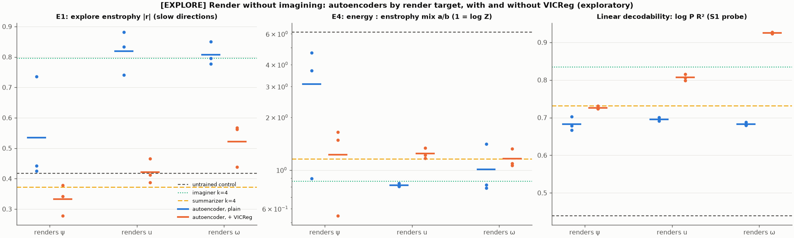

# [EXPLORE] Stage 2 summary: which conserved quantities are prominent in a latent, and why

2026-10-17. Exploratory; nothing here is a finding. Only Stage 3 (sealed `confirm` set, frozen
checkpoints, a committed `PREREGISTRATION_v2.md`) can produce a claim. Brief and agreed changes:
`BRIEF.md`; predictions and every protocol change, in order: `PREDICTIONS.md` entries 1–7.
Wording rule: these statistics say which conserved quantities are *prominent in a latent* (its
slowest unsupervised directions), not that a model discovered conservation.

## Bottom line

- **Enstrophy becomes prominent when an unregularized model is trained to render a field.** The
  pixel predictor (renders the future) and a plain autoencoder (renders the present, no dynamics at
  all) reach the same level. Explore E1 (best-of-top-3 slow-direction |r| with log Z₀): imaginer
  k = 4 **0.80**, autoencoder rendering u **0.82**, rendering ω **0.81**; untrained control 0.42.
- **Imagining the future is not the ingredient.** The imaginer's E1 does not grow with horizon
  (0.68–0.80 over k = 1–32), and rendering the present matches it.
- **The VICReg regularizer is the switch.** Adding the JEPA's variance/covariance terms to the
  autoencoders drops E1 to control level (u 0.82 → 0.42, ω 0.81 → 0.52, ψ 0.53 → 0.33), the same
  level as the JEPA summarizer (0.31–0.46). It simultaneously *raises* linear decodability (ω: log P
  R² 0.68 → 0.93). So the original imaginer-vs-summarizer gap looks like a regularization effect,
  not rendering vs summarizing: prominence is about how the latent allocates variance, not about
  what it contains.
- **What is rendered shifts the energy–enstrophy mix.** The enstrophy-tracking direction's mix of
  log E₀ and log(Z₀/E₀) (E4, 1 = exactly log Z): rendering ω **1.01**, u 0.82, ψ 3.1 (leans to
  energy, like the untrained control's 6.1).
- **Prominent is not the same as used.** Neither probe found the decoder using an enstrophy-specific
  variable: shifting the latent along the enstrophy direction barely changes the rendered field, and
  scaling the map's spatial contrast scales the whole rendered field's amplitude (Z, E and P alike).

## Results by step

**Horizon sweep** (lr 1e-3; imaginer seeds per k = 2/3/1/3; summarizer 3 each). Tables:
`stage2/eval_step1.md` and `stage2/eval.md`; figure `stage2/primary.png`.

| k | imaginer E1 | summarizer E1 | gap [95% CI] |
|---|---|---|---|
| 1 | 0.68 | 0.31 | +0.37 [+0.31, +0.43] |
| 4 | 0.80 | 0.37 | +0.42 [+0.36, +0.48] |
| 16 | 0.69 (1 seed) | 0.38 | +0.31 [+0.24, +0.39] |
| 32 | 0.76 | 0.46 | +0.30 [+0.25, +0.35] |

Bridge (k = 4 trained on the original distribution, inviscid included): 0.84, so dropping
inviscid flow from training changed nothing. Matched-energy E5: every trained model 0.87–0.99,
control 0.18, so E5 separates trained from untrained but not imaginer from summarizer.

**Render-target autoencoders** (3 seeds each, none diverged):

| model | E1 [95% CI] | E2 partial r | E3 r(Z₀ \| P̄) | E4 a/b (R²) | energy \|r\| | E5 |
|---|---|---|---|---|---|---|
| renders ψ | 0.53 [0.49, 0.58] | 0.43 | 0.75 | 3.10 (0.73) | 0.90 | 0.97 |
| renders u | 0.82 [0.79, 0.84] | 0.91 | 0.74 | 0.82 (0.85) | 0.91 | 0.98 |
| renders ω | 0.81 [0.79, 0.83] | 0.94 | 0.83 | 1.01 (0.89) | 0.89 | 0.97 |
| renders ψ + VICReg | 0.33 [0.29, 0.39] | 0.58 | 0.28 | 1.23 (0.30) | 0.56 | 0.93 |
| renders u + VICReg | 0.42 [0.37, 0.48] | 0.69 | 0.50 | 1.24 (0.22) | 0.54 | 0.94 |
| renders ω + VICReg | 0.52 [0.48, 0.57] | 0.70 | 0.55 | 1.16 (0.30) | 0.52 | 0.93 |

The ψ autoencoder is seed-sensitive (E1 0.74, 0.44, 0.43).

**Probes** (`probe.md`, `contrast_probe.md`). Imagination probe (shift along the enstrophy
direction): rendered log Z moves by about ±1–5% at ±2 std, within the random-direction range, and Z,
E, P move together. Contrast probe (post hoc): scaling the map's spatial variation moves rendered
log Z, log E, log P by the same ~2 per unit ε (ratio 1.00 in all 9 models); scaling its spatial
mean barely matters.

## Predictions scorecard

| | prediction | outcome |
|---|---|---|
| P2.1 | bridge within ±0.1 of the k = 4 imaginer | held |
| P2.2 | imaginer E1 ≥ 0.6 at every k, range < 0.15 | held |
| P2.3 | summarizer ≥ 0.2 below imaginer and ≤ 0.5 at every k | held |
| P2.4 | E5 ≥ 0.8 for every trained model | held |
| P2.5 | blur: high-k energy ratio < 0.5 (k = 16), < 0.25 (k = 32) | partly failed (0.53 at k = 16) |
| P2.6, P2.7 | pixel + VICReg / fake physics at k\* | not run (dropped in entry 6) |
| P2.8 | specificity at k = 4 ≥ 0.3 | held (0.70) |
| P2.9 | lr selection | held |
| P2.10 | ~13 GPU-h | failed (divergences; see compute) |
| P6.1 | the decoder uses the enstrophy direction | **failed** (all 3 seeds) |
| P6.2 | E1 order ω > u > ψ | failed (u ≈ ω > ψ) |
| P6.3 | energy |r| highest for u or ψ, lowest for ω | held, but differences within noise |
| P6.4 | rendering the present ≈ the imaginer (within 0.15) | **held** (0.82 vs 0.80) |
| P6.5 | VICReg lowers E1 by ≥ 0.2 for every target | **held** (−0.20, −0.40, −0.29) |
| P6.6 | E5 ω ≥ 0.8, ψ lowest | held, but all plain autoencoders ≈ 0.97 |
| P7.1–P7.3 | contrast is enstrophy-specific | failed (post hoc) |

## Threats to keep in view

- **Training instability.** At constant lr the pixel models diverged often (11 of 24 imaginer-family
  runs across two lrs); analyses use only runs that trained, and k = 16 rests on one seed. The
  autoencoders used gradient clipping and a cosine schedule and none diverged; the imaginer and
  summarizer did not use clipping, so recipes differ between those families and the autoencoders.
- **Horizon vs training length.** Short horizons trained 12,000 steps, long ones ~5,000–9,000.
- **Many comparisons.** Stages 0–2 tried many things; seed counts are 3 (or fewer); the bootstrap CIs
  ignore seed variance. This is why only Stage 3 counts.
- **Prominence vs information.** VICReg models decode the same quantities linearly *better*, so the
  effect concerns latent geometry under this particular unsupervised method (z-score → PCA 32 →
  within/between eigenproblem), not what the models know.
- **No regularization-free summarizer.** A JEPA without VICReg collapses, so "summarize without
  regularization" could not be tested in this architecture.

## Candidate hypotheses for Stage 3 (to be fixed in PREREGISTRATION_v2.md if you approve)

Frozen checkpoints (the 18 autoencoders, the three k = 4 imaginers, the three k = 4 summarizers, the
three untrained controls), evaluated once on the sealed `confirm` set (1,005 trajectories, 378
inviscid) with the same E1/E4 code:

- **H1 (rendering).** Plain u- and ω-autoencoders each have confirm E1 ≥ 0.70 and exceed the
  untrained control by ≥ 0.25, paired trajectory-bootstrap CI excluding 0.
- **H2 (regularization).** For u and ω, the VICReg variant's E1 is ≥ 0.20 below the plain variant's,
  CI excluding 0.
- **H3 (render target).** The ω-autoencoder's E4 ratio is closer to 1 than the ψ-autoencoder's
  (|log a/b| smaller), with ψ's ratio > 2.
- Reported, unscored: imaginer vs summarizer at k = 4; linear-decodability changes under VICReg.

## Compute

[EXPLORE] logged wall-clock: 24.5 h (78 log entries: data, Stages 0–1, 43 Stage 2 training runs
including diverged and lr-selection runs, 18 autoencoders, evaluations, probes, smokes), within the
28 GPU-hour budget. RTX 3060, as before.
